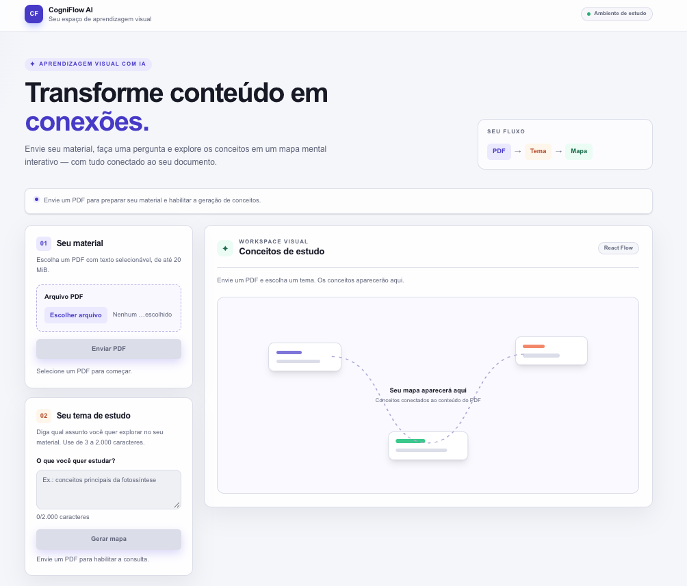

# CogniFlow AI

**Traduzindo Texto Denso em Aprendizado Visual**

O **CogniFlow AI** é uma plataforma educacional assistiva que utiliza **RAG (Retrieval-Augmented Generation)** e **IA Generativa** para converter materiais acadêmicos densos (PDFs, apostilas e transcrições) em mapas mentais visuais estruturados, reduzindo a sobrecarga cognitiva para estudantes surdos (Português como L2) e neurodivergentes (TDAH/TEA).



---

## Principais Recursos Pedagógicos e de Acessibilidade

- **Mapa Mental do Material Inteiro (map-reduce)**: cada seção do PDF é lida separadamente pelo LLM (*map*) e os conceitos são unidos e organizados em uma árvore **Tema Central (`root`) → Eixos de Estudo numerados (`topic`, de 3 a 5) → Conceitos (`concept`, até 5 por eixo) → Exemplos (`example`, até 2 por conceito)** (*reduce*). Cada nó cita os trechos de origem do PDF, e cada tipo de relação aparece sempre com o mesmo verbo (vocabulário controlado).
- **Falhas Explícitas, sem Substitutos**: se uma seção não puder ser processada, o mapa é entregue como `partial`, indicando a seção, que pode ser reprocessada sozinha. Nenhum conteúdo é gerado por regras fixas no lugar da IA.
- **Acessibilidade Linguística e Cognitiva (Surdos, TDAH e TEA)**:
  - **Surdos (Português L2)**: Frases em ordem direta (`Sujeito → Verbo → Objeto`) e voz ativa, evitando subordinações longas.
  - **TEA**: Linguagem 100% literal e objetiva, sem metáforas ou ambiguidades.
  - **TDAH**: Expansão de siglas na primeira menção, diferenciação visual semântica por cores/categorias e prévia do resumo diretamente nos cartões do grafo para reduzir a atenção dividida (*split-attention effect*).
- **Alternância Visual / Textual sem Perda de Estado**: Transição imediata entre o **Mapa** interativo (React Flow + layout automático Dagre) e a visualização em **Lista** estruturada (acessível para leitores de tela e navegação integral por teclado), preservando posições, zoom e nó selecionado.
- **IA 100% Local com Ollama**: LLM `llama3.2:3b` e embeddings `bge-m3` executados na própria máquina (privacidade LGPD), com verificação de prontidão em `GET /api/health`. As interfaces de provedor permitem reintroduzir outros serviços, como o Google Gemini, no futuro.

---

## Arquitetura do Projeto

```text
cogniflow-ai/
├── docker-compose.yml                        # PostgreSQL 16 (pgvector) + Ollama + pull automático de modelos
├── Proposta_Projeto_CogniFlow_AI.pdf         # PDF da proposta do projeto para testes e demonstração
├── fotossintese-texto-selecionavel.pdf       # PDF didático adicional para testes de estudo
├── docs/                                     # Documentação de arquitetura e assets visuais
│   ├── arquitetura-frontend.md               # Detalhamento da estrutura do frontend
│   └── cogniflow-interface.png               # Captura da interface do CogniFlow AI
├── specs/                                    # Planos de execução e evolução técnica/pedagógica
│   ├── execution_plan.md                     # Plano de execução original dividido em 5 Sprints
│   ├── improvements_plan_01.md               # Coerência pedagógica e hierárquica de mapas mentais
│   └── improvements_plan_02.md               # Abrangência RAG adaptativa e acessibilidade cognitiva
├── backend/                                  # API Orquestradora (Python + FastAPI + Clean Architecture)
│   ├── app/
│   │   ├── core/                             # Configurações (Pydantic Settings), logs e conexão assíncrona DB
│   │   ├── repositories/                     # Persistência e busca por similaridade vetorial (pgvector)
│   │   ├── routers/                          # Endpoints REST (/api/health, /api/documents, /mind-map, /ask)
│   │   ├── schemas/                          # Contratos estritos de entrada/saída (Pydantic)
│   │   ├── services/                         # PDF parser, chunking, estruturação pedagógica, RAG, LLM e métricas
│   │   └── use_cases/                        # Regras de negócio da aplicação
│   ├── scripts/
│   │   ├── init_db.sql                       # Script de inicialização da extensão vector
│   │   └── demo_pitch.py                     # Script de demonstração ao vivo para o Pitch
│   └── tests/                                # Suíte de testes automatizados (PyTest + Testcontainers)
└── frontend/                                 # Next.js 16 + TypeScript + Tailwind + React Flow
    ├── app/                                  # App Router, layout e estilos globais
    ├── components/                           # Composição do workspace e componentes compartilhados
    ├── features/                             # Módulos documents e mind-map (componentes, hooks, schemas e serviços)
    ├── services/                             # Cliente HTTP compartilhado
    ├── test-utils/                           # Utilitários para testes de integração com a API real
    └── e2e/                                  # Playwright: interação, acessibilidade (axe-core) e fluxo real
```

Consulte a [estrutura do frontend](docs/arquitetura-frontend.md) para conhecer em detalhes a organização das páginas, componentes, features, serviços e testes.

---

## Pré-requisitos

- **Docker** e **Docker Compose** (para o banco PostgreSQL + `pgvector`, servidor `Ollama` e testes com Testcontainers)
- **Python 3.11+** e `pip`
- **Node.js 20.19+** na linha 20, **22.12+** na linha 22 ou **24+**, e `npm`

---

## 1. Subindo a Infraestrutura com Docker Compose (`pgvector` + `Ollama`)

Na raiz do projeto, inicie os serviços de infraestrutura:

```bash
docker compose up -d
```

Esse comando provisiona:
- **`cogniflow_pgvector`** (`pgvector/pgvector:pg16` na porta `5432`): banco de dados PostgreSQL 16 com a extensão `vector` inicializada automaticamente.
- **`cogniflow_ollama`** (`ollama/ollama:latest` na porta `11434`): servidor local para execução de LLMs e embeddings abertos.
- **`cogniflow_ollama_init`**: container auxiliar que baixa automaticamente os modelos padrão (`bge-m3` para embeddings e `llama3.2:3b` como LLM) assim que o serviço `ollama` fica saudável.

> **Requisitos de hardware:** os modelos `llama3.2:3b` (≈ 2 GB) e `bge-m3` (≈ 1,2 GB) exigem cerca de **4 GB de RAM livres** e ≈ 3,5 GB de disco no volume `ollama_data`. Sem GPU, a geração funciona em CPU, porém mais lenta.
>
> **Paralelismo:** a variável `OLLAMA_NUM_PARALLEL` (padrão `1` no `docker-compose.yml`) define quantas requisições cada modelo atende ao mesmo tempo. Com `1`, as chamadas são processadas em série e o uso de memória fica previsível; aumente apenas se houver memória sobrando.

> **Importante:** o backend depende do Ollama para gerar embeddings e respostas. Sem ele, `GET /api/health` responde `"status": "degraded"` com o motivo no campo `issues`.

Para verificar o status dos containers e acompanhar o download inicial dos modelos do Ollama:

```bash
docker compose ps
docker compose logs -f ollama_init
```

---

### 1.1. Atualizando um Banco Criado por uma Versão Anterior

A partir do `improvements_plan_03`, os embeddings passaram a ser gerados pelo `bge-m3` (**1024 dimensões**) e cada trecho guarda a seção e as páginas de origem. Vetores do modelo anterior não são comparáveis com os do `bge-m3`, por isso os dados antigos não podem ser convertidos: a tabela é recriada e os PDFs precisam ser **enviados novamente**.

```bash
docker compose exec -T postgres psql -U cogniflow -d cogniflow_db < backend/scripts/migrate_03.sql
```

Em seguida, reinicie o backend: as tabelas `documents` e `document_chunks` e o índice HNSW são criados na inicialização. Enquanto a migração não for executada, o backend registra o problema no log e `GET /api/health` responde `"status": "degraded"` indicando o script a rodar.

> **Requisito:** pgvector **0.8 ou superior** (a imagem `pgvector/pgvector:pg16` já atende), necessário para as buscas iterativas no índice HNSW quando a consulta filtra por documento.

---

## 2. Configurando e Rodando o Backend (FastAPI)

### 2.1. Configurar Variáveis de Ambiente

Entre no diretório `backend/` e crie o arquivo `.env` a partir do template `.env.example`:

```bash
cd backend
cp .env.example .env
```

> **Provedor de IA (`EMBEDDING_PROVIDER` e `LLM_PROVIDER`):** nesta versão, o único provedor suportado é o **Ollama** (`"ollama"`), executado localmente — nenhum dado do material sai da máquina. Qualquer outro valor faz o backend falhar na inicialização.
> - `OLLAMA_EMBEDDING_MODEL="bge-m3"` e `EMBEDDING_DIMENSION=1024`: embeddings multilíngues com bom desempenho em português.
> - `OLLAMA_LLM_MODEL="llama3.2:3b"` e `OLLAMA_NUM_CTX=8192`: modelo de 3B parâmetros e tamanho da janela de contexto.
> - O suporte ao **Google Gemini** foi suspenso nesta versão; o código do provedor foi mantido como ponto de extensão para o futuro.

### 2.2. Criar Ambiente Virtual e Instalar Dependências

Caso o ambiente `.venv` ainda não exista:

```bash
python3 -m venv .venv
source .venv/bin/activate
pip install -r requirements.txt
```

*(Caso já exista o `.venv` criado no diretório `backend/`, basta ativá-lo com `source .venv/bin/activate` ou executar diretamente `./.venv/bin/uvicorn`).*

### 2.3. Iniciar o Servidor FastAPI

Dentro da pasta `backend/`:

```bash
./.venv/bin/uvicorn app.main:app --reload --host 0.0.0.0 --port 8000
```

O backend estará disponível em:
- **API Base URL**: http://localhost:8000
- **Documentação Interativa (Swagger UI)**: http://localhost:8000/docs
- **Redoc**: http://localhost:8000/redoc

---

## 3. Configurando e Rodando o Frontend (Next.js)

Em um novo terminal, acesse a pasta `frontend/`:

### 3.1. Configurar Variáveis de Ambiente

```bash
cd frontend
cp .env.example .env.local
```

Por padrão, `NEXT_PUBLIC_API_BASE_URL=http://localhost:8000` conecta o frontend ao FastAPI local.

### 3.2. Instalar Dependências e Rodar em Modo de Desenvolvimento

```bash
npm ci
npm run dev
```

O frontend estará disponível em:
- **Aplicação Web**: http://localhost:3000

Na interface:
1. Envie um arquivo PDF (ex.: `Proposta_Projeto_CogniFlow_AI.pdf` ou `fotossintese-texto-selecionavel.pdf`).
2. Informe o tema ou dúvida de estudo e escolha a **Abrangência do mapa** (**Essencial — 5 trechos**, **Detalhada — 10 trechos**, **Ampla — 15 trechos** ou **Completa — 20 trechos**).
3. Explore os conceitos no **Mapa** visual (com código de cores para *Tema central*, *Eixo temático*, *Conceito* e *Exemplo prático*) ou selecione **Lista** para leitura linear estruturada. A alternância preserva posições, zoom e seleção do mapa.

Detalhes da arquitetura de componentes e fluxo de dados estão em [docs/arquitetura-frontend.md](docs/arquitetura-frontend.md).

Para gerar o build de produção do frontend:

```bash
npm run build
npm run start
```

---

## 4. Testando os Endpoints da API (Exemplos via `curl`)

Com o banco de dados e o backend rodando em `http://localhost:8000`:

### 4.1. Health Check (`GET /api/health`)

```bash
curl -X GET http://localhost:8000/api/health
```

### 4.2. Ingestão e Vetorização de um PDF (`POST /api/documents/ingest`)

```bash
curl -X POST http://localhost:8000/api/documents/ingest \
  -F "file=@Proposta_Projeto_CogniFlow_AI.pdf;type=application/pdf"
```

A resposta inclui `document_id`, `page_count` e `total_chunks`. Se o Ollama estiver indisponível, a ingestão responde **HTTP 503** e nada é gravado — uma versão anterior do mesmo PDF permanece intacta.

### 4.3. Consulta de Chunks Armazenados de um Documento (`GET /api/documents/{document_name}/chunks`)

```bash
curl -X GET http://localhost:8000/api/documents/Proposta_Projeto_CogniFlow_AI.pdf/chunks
```

Cada trecho traz `section_title`, `page_start` e `page_end`, usados para citar a página de origem.

### 4.4. Mapa Mental do Material Inteiro (map-reduce)

O mapa é gerado **automaticamente em segundo plano** logo após a ingestão, cobrindo o PDF inteiro (sem pergunta nem `top_k`):

1. **Map:** uma chamada ao LLM por seção do PDF extrai os conceitos-chave, cada um citando os trechos de origem (`source_chunks`).
2. **Reduce:** conceitos repetidos entre seções são unidos por similaridade de embeddings; depois o LLM organiza de 3 a 5 eixos de estudo numerados, com até 5 conceitos cada.

Acompanhe o progresso e obtenha o mapa usando o `document_id` devolvido pela ingestão:

```bash
curl http://localhost:8000/api/documents/<document_id>/mind-map
```

O campo `status` vale `pending`, `processing`, `ready`, `partial` (mapa gerado sem algumas seções, listadas em `failed_sections`) ou `failed`. O campo `progress.message` traz uma mensagem literal, como *"Lendo a seção 3 de 12: Cloroplastos."*. Reenviar um PDF idêntico reaproveita o mapa já gerado.

```bash
# Gerar o mapa novamente
curl -X POST http://localhost:8000/api/documents/<document_id>/mind-map/regenerate
# Reprocessar apenas uma seção que falhou
curl -X POST http://localhost:8000/api/documents/<document_id>/mind-map/sections/<section_index>/retry
```

> O endpoint antigo `POST /api/generate-map` foi aposentado e responde **HTTP 410**.

### 4.5. Tutor Tira-Dúvidas (`POST /api/documents/{document_id}/ask`)

O aluno pergunta e o tutor responde **somente com base no PDF da aula** (RAG), sempre na mesma estrutura: resposta direta → até 3 tópicos → exemplo do material → termos técnicos definidos → trechos citados com página.

```bash
curl -X POST http://localhost:8000/api/documents/<document_id>/ask \
  -H "Content-Type: application/json" \
  -d '{
    "question": "E onde ela acontece?",
    "history": [
      {"role": "student", "content": "O que é a fase clara?"},
      {"role": "tutor", "content": "A fase clara é a etapa da fotossíntese que usa a luz."}
    ]
  }'
```

- `history` (opcional, até 4 trocas): o tutor reescreve a pergunta em forma completa antes de buscar no material.
- `node_id` (opcional): dúvida sobre um conceito do mapa; os trechos de origem do conceito entram sempre no contexto.
- Se o trecho mais parecido tiver similaridade abaixo de `TUTOR_MIN_SIMILARITY`, ou se o modelo indicar que o material não responde, a resposta é `"found_in_material": false` com a mensagem fixa *"Não encontrei isso no material da aula."* e até 2 conceitos do mapa relacionados — sem chamar o LLM no primeiro caso.
- Se o Ollama estiver indisponível ou o modelo continuar respondendo fora do formato após 2 correções, a API responde **HTTP 503** (*"O tutor está indisponível no momento. Tente novamente em instantes."*). Nunca é devolvida uma resposta montada sem o LLM.

---

## 5. Executando os Testes e a Demonstração do Pitch

### 5.1. Rodar a Suíte Completa de Testes do Backend (PyTest + Testcontainers)

Na raiz do projeto (com o serviço do Docker ativo, pois o **Testcontainers** sobe automaticamente uma instância isolada do `pgvector/pgvector:pg16`):

```bash
./backend/.venv/bin/pytest -c backend/pyproject.toml backend/tests -v
```

Esses testes usam provedores falsos de IA e verificam o encadeamento das etapas, **não** a qualidade pedagógica. A avaliação com os modelos reais é separada e exige o Ollama rodando com os modelos baixados:

```bash
./backend/.venv/bin/pytest -c backend/pyproject.toml backend/tests -m llm -v
```

### 5.2. Rodar o Script de Demonstração ao Vivo (Pitch)

Para executar a conversão fim-a-fim do PDF da proposta (ingestão em memória + map-reduce, com o Ollama) com medição de **Recall** e **Latência**:

```bash
PYTHONPATH=backend ./backend/.venv/bin/python backend/scripts/demo_pitch.py
```

### 5.3. Verificar o Frontend (Lint, Tipos, Testes Unitários e E2E)

Em outro terminal, a partir da pasta `frontend/`:

```bash
cd frontend
npm run lint
npx tsc --noEmit
npm test
npm run build
```

#### Testes End-to-End e Auditoria de Acessibilidade (Playwright + axe-core)

- **Execução padrão (com API simulada):** Valida interações do grafo, navegação por teclado, alternância Mapa/Lista e auditorias automáticas de acessibilidade (`axe-core`) sem exigir o backend ativo:
  ```bash
  npm run test:e2e
  ```

- **Execução integrada fim-a-fim (com FastAPI e `pgvector` reais):** Com o banco e o backend rodando em `http://127.0.0.1:8000`, habilite a variável `COGNIFLOW_INTEGRATION_URL` para executar também o fluxo real de upload de PDF, geração de mapa e leitura textual (`e2e/real-study-flow.spec.ts`):
  ```bash
  COGNIFLOW_INTEGRATION_URL=http://127.0.0.1:8000 npm run test:e2e
  ```
